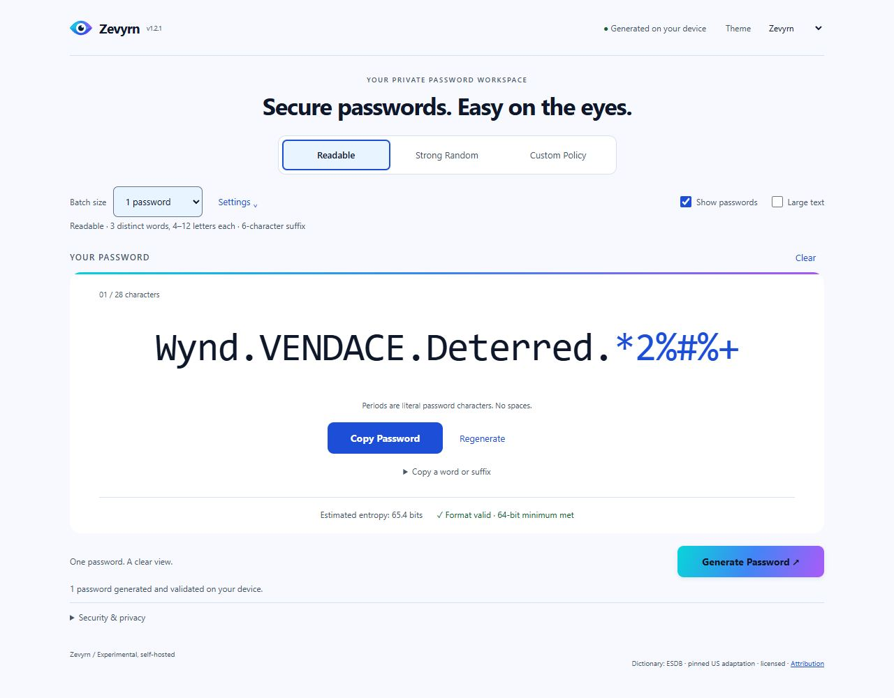
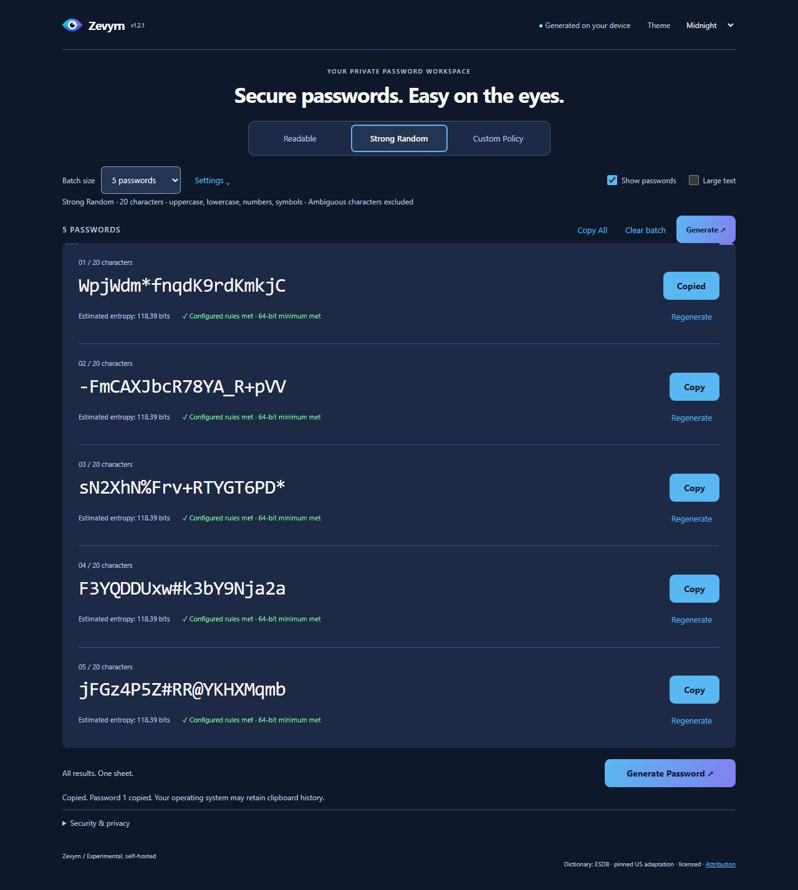
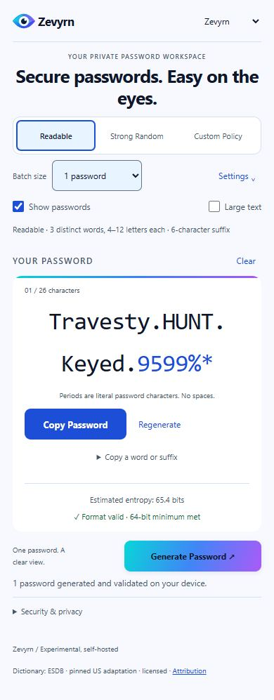

# Zevyrn (pronounced “ZEV-urn”)

**Secure passwords. Easy on the eyes.**

Current application version: **1.2.1**.

Self-hosted password generation in your browser. Zevyrn provides Readable,
Strong Random and Custom Policy profiles, single-password and batch views,
copying controls, Large Text and five themes: Zevyrn (default), Midnight, Aurora, Dusk and Slate.

Passwords are generated on your device using Web Crypto. There is no backend
password storage, telemetry or external dictionary service. Only the selected
theme is saved. Clear does not erase OS clipboard history or securely wipe memory.

## Supported deployment

Zevyrn source code and Docker images are intended for public distribution.
Running Zevyrn is supported only on private or internal networks, including
localhost. Direct internet-facing deployment is outside the supported
configuration. Operators are responsible for controlling access; the current
application scope does not require an application authentication system.

Internal reverse proxies and trusted HTTPS are supported. Private-network
placement does not eliminate application, browser or dependency risks. See
[internal-network access](INSTALLATION.md#access-from-other-internal-devices).

## Install the prebuilt container (recommended)

The qualified release image is `ghcr.io/thestateofwhere/zevyrn:1.2.1`
for **Linux/amd64**. See the [v1.2.1 release](https://github.com/TheStateOfWhere/zevyrn-password-generator/releases/tag/v1.2.1)
for publication status and the verified immutable digest. Use the commands below
only after publication and verification; do not substitute an unverified image.

Use a maintained Docker Engine 28 or newer (or Docker Desktop in Linux-container
mode) and Docker Compose v2 or newer with `--wait` and `--wait-timeout`. Git, Node.js, npm
and Buildx are not needed to run the prebuilt image. Download
[`compose.ghcr.yaml`](compose.ghcr.yaml) from the intended published release into
an otherwise empty directory. Commands use a POSIX shell; use your existing
Docker access method, including `sudo` if required.

```sh
docker version
docker compose version
docker compose -p zevyrn -f compose.ghcr.yaml config
docker compose -p zevyrn -f compose.ghcr.yaml pull zevyrn
docker compose -p zevyrn -f compose.ghcr.yaml up -d --no-build --pull never --wait --wait-timeout 120 zevyrn
curl --fail http://127.0.0.1:18080/healthz
```

Expect `ok`, then open **http://localhost:18080** on the Docker host. The container
listens on **8080**; this example binds host **18080 to loopback only**. There is
no database, persistent app volume or required application environment variable.
`ZEVYRN_PORT` changes the host port; `ZEVYRN_IMAGE` selects an explicit published
tag or `ghcr.io/thestateofwhere/zevyrn@sha256:<published-manifest-digest>`.
Keep overrides in your own `.env` and use the same settings on every command.
See [installation and updates](INSTALLATION.md#prebuilt-image-recommended).

For browsers on other internal devices, use an internal reverse proxy with HTTPS
and a hostname/certificate that you control. Localhost or a secure HTTPS context is required for copying;
plain HTTP on a remote IP is insufficient. No particular host, shared network,
certificate authority or existing proxy is assumed.

Choose one complete file; plain `docker compose up` selects the legacy installation:

| Installation | Compose file |
| --- | --- |
| Published prebuilt image | `compose.ghcr.yaml` |
| Local source build | `compose.zevyrn.yaml` |
| Source build with HTTPS | `compose.zevyrn.traefik.yaml` **or** `compose.zevyrn.caddy.yaml` |
| Existing KeySmith installation | Keep its original Compose file and project name |

The supported container target is **Linux/amd64**: native x86-64 Linux, or
Docker Desktop using Linux containers. ARM hosts (including Apple Silicon)
would need amd64 emulation and have not been validated. Windows-container mode
is unsupported. See [platforms and prerequisites](INSTALLATION.md#platforms-and-prerequisites).

## Optional developer source build

To build locally, clone this repository, select the intended release tag or
reviewed commit, and use `compose.zevyrn.yaml`. Git and Buildx are needed in
addition to Docker/Compose; Node/npm run inside the builder. The first build
needs container registries, npm and Alpine repositories.

```sh
git clone https://github.com/TheStateOfWhere/zevyrn-password-generator.git
cd zevyrn-password-generator
# Select a published tag or reviewed commit containing the portable-build correction:
git checkout --detach <TAG_OR_FULL_COMMIT>
docker compose -p zevyrn -f compose.zevyrn.yaml config
docker compose -p zevyrn -f compose.zevyrn.yaml build zevyrn
docker compose -p zevyrn -f compose.zevyrn.yaml up -d --no-build --pull never --wait --wait-timeout 120
```

The local image is `zevyrn:1.2.1-local`. Tests run during the build. A new source
build is a different artifact and does not inherit the retained release image's
qualification. Do not bypass tests or pinned inputs.
Project metadata is verified against exact Git LF bytes; an ordinary checkout
needs no historical qualification workspace or line-ending conversion. The
Docker build needs no host Python or Node installation. This correction does
not resolve the existing builder security blocker or authorize a release.

## HTTPS: choose Traefik or Caddy

The optional internal-network source-build proxy examples in
[INSTALLATION.md](INSTALLATION.md) use an existing certificate. Both source-build examples create their own project network, publish only TCP 443,
and route to `zevyrn:8080`. No Docker socket or external proxy network is needed.
Use one complete Compose file at a time; do not combine the alternatives.

| Option | Compose file | Browser address |
| --- | --- | --- |
| Local only | `compose.zevyrn.yaml` | `http://localhost:18080` |
| Traefik + existing certificate | `compose.zevyrn.traefik.yaml` | `https://<your-domain>` |
| Caddy + existing certificate | `compose.zevyrn.caddy.yaml` | `https://<your-domain>` |

Provide a DNS record pointing to your Docker host, a certificate whose DNS SAN
matches that name, and client trust in the issuing CA. Private hostnames need a
trusted private-CA certificate. The examples do not issue certificates or create
a CA. Keep private keys outside this repository. Port 80 is not required by these
existing-certificate examples. HTTPS or localhost is required for browser copying.

Choose a hostname you control and set `ZEVYRN_DOMAIN` to that bare name, without
`https://` or a port. Public DNS and internal DNS are both supported; clients must
use a resolver that knows the record. A public DNS name does not require public
Internet access to the application and does not make direct internet-facing
deployment supported. Keep access limited to intended internal users. See
[DNS and certificate trust](INSTALLATION.md#choose-a-hostname-and-client-trust)
and the [update commands](INSTALLATION.md#updates).

## Troubleshooting

```sh
docker compose -p zevyrn -f compose.ghcr.yaml ps
docker compose -p zevyrn -f compose.ghcr.yaml logs --tail 100 zevyrn
curl --fail http://127.0.0.1:18080/healthz
```

For HTTPS, use the same `-p` and `-f` options as your installation when checking
status or logs. A 502 usually means the app is unhealthy or the proxy cannot reach
`zevyrn:8080`. A certificate warning means the hostname, chain, expiry or client
trust needs attention; do not treat `curl -k` as a successful HTTPS test.
If a port is occupied, choose another port or host address; do not stop another
application. For prebuilt installs, pull the selected published image; for developer installs, build explicitly.
See [INSTALLATION.md](INSTALLATION.md) for updates and removal.
For unhealthy/exited containers, a healthy container with a loading page, or
reporting a reproducible problem, use the [diagnostic checklist](INSTALLATION.md#diagnostic-checklist).

## Existing installations

Keep your original Compose file, project, service, environment variables and TLS
paths. The legacy `compose.yaml`, `compose.traefik.yaml`, `compose.caddy.yaml`,
`.env.example` and proxy configurations remain unchanged. Do not switch projects
or services just to update. Follow the [existing-installation update path](INSTALLATION.md#existing-installations).
The new Zevyrn files are complete alternatives, not overlays on legacy files.

## Screenshots

Captured from the accepted, unreleased development baseline `0fa0a77a` at
1280px desktop and 390px mobile widths. All visible passwords are public,
deterministic demonstration data and must never be used as credentials.
Clipboard feedback is shown using a simulated success response.

### Main interface and active settings



### Five-password batch and local copy feedback



### Mobile layout



Earlier v1.1.0 theme previews remain available for historical reference:
[Midnight](docs/screenshots/desktop-midnight.jpg),
[Aurora](docs/screenshots/desktop-aurora.jpg),
[Dusk](docs/screenshots/desktop-dusk.jpg) and
[Slate](docs/screenshots/desktop-slate.jpg). The current visual themes are unchanged.

## Development and licensing

See [CONTRIBUTING.md](CONTRIBUTING.md) for local tests and [SECURITY.md](SECURITY.md)
for reporting and security boundaries. Other CPU architectures and physical mobile,
screen-reader and full cross-browser behavior have not been qualified. Existing
automated browser coverage uses Microsoft Edge on Windows.

Application: [MIT](LICENSE). Dictionary data retains its separate licenses and
[attribution](data/NOTICE.md). Application and third-party notices are included in
the built `/licenses/` assets. Historical project names in `data/NOTICE.md` are
retained verbatim to preserve pinned dictionary attribution and provenance; the
current product name is Zevyrn.

Project: [TheStateOfWhere/zevyrn-password-generator](https://github.com/TheStateOfWhere/zevyrn-password-generator).
The [repository rename notes](docs/REPOSITORY-RENAME.md) describe the completed
rename and retained compatibility identifiers. Existing Docker image,
service, project and `KEYSMITH_*` configuration names remain compatible.
